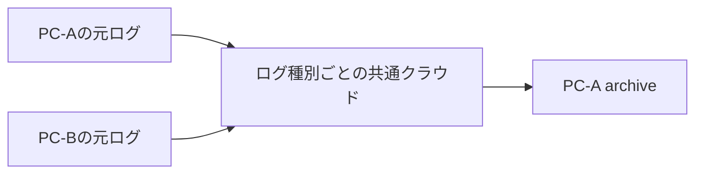

# ログ移動システム 設計書

文書版: 1.0 / 更新日: 2026-10-27（日本時間）
位置付け: [要件定義書](../requirements/log-move-requirements.md)を実装へ接続する正式な設計の入口。
確定範囲: 2経路・平坦化・Q5・同名処理・通常再実行・Q11・Q12の要件と役割境界。
未確定範囲: 本文で「案」「候補」「未確認」と示すAPI/FS能力・記録形式/状態/IPC・永続化等。正式文書化によって候補を採用済みにしない。
実装/受け入れ: 未完。[実装計画](../development/implementation-workflow.md)と[現行handoff](../handoff/next-chat.md)を参照。コード/schemaや旧artifactは今回変更しない。

## 0. 全体構成と責務

各矢印はコピー/保存先確認/元不変確認/確認済み元の直接削除までを含む移動。古いA元もクラウド経由。移動は元ファイル単位で確定し、他PCの期間完了を待たない。

PowerShellは設定/役割/対象選択、移動の順序・判定、retry、記録と結果表示を制御する。Pythonは現在のDrive adapter契約に従い1回のAPI試行を担う。新しいcloud削除のoperation/型/権限と、ローカル実体を保つ削除方式は未完。必要な観測・実体結合を確認せず、汎用削除APIへ対象名だけを渡す実装にしない。

設定/容量/排他/復旧/Dry Run/配布等の維持する契約は[開発参照表](../development/development-guide.md)を参照。既存v1/helperの純粋な検査を移動完了/削除認可へ昇格しない。

## 1. 確認の目的と範囲

削除してよいのは、保存先へ内容が残り、かつ削除直前の元がコピー時から変わっていないことを確認できた元ファイルだけ。移動元の識別、内容の比較、実際の削除対象を一つのファイルに結び付ける。保存先があるだけで、同じ名前の元をまとめて削除しない。

対象は各端末→クラウドとクラウド→A archive。平坦化・同内容再利用・異内容保留・通常再実行を維持する。実装を開始する指示や実データへの操作許可ではない。

## 2. ファイルを結び付ける情報（案）

| 項目 | ローカルファイル | クラウドファイル |
| --- | --- | --- |
| 論理位置 | 端末、承認済み元/保存先root、ログ種別、rootからの相対パス | 対象クラウド領域、親フォルダ、ログ種別、ファイル名 |
| 実体識別 | その時点で開いたファイルの識別と、対象pathとの対応 | providerのファイルIDと、期待する親/名前との対応 |
| 内容 | コピー対象の実bytes、size、SHA-256 | 同じIDに結び付いた信頼できる内容hash、または実downloadのsize/SHA-256 |
| 観測状態 | 読取前後の実体/size/更新状態、読取の完了 | 読取/確認時点の状態、利用可能なら変更世代・版情報 |

この表は意味上の情報で、schema field名を定義しない。Windowsの具体的な実体識別方法やDriveの変更世代/条件付き操作の利用可否は、実装対象で確認する。path・更新時刻・sizeだけを不変の証拠にしない。クラウドのIDだけでも内容が不変とはしない。

保存先の論理位置は「ログ種別の共通root＋元basename」。元の相対パスは保存先階層へ引き継がず、元を区別する記録として保持する。A/Bや別サブフォルダの同名元は別の移動対象。保存先の候補が一意に特定できなければ保留し、出所を名前から推測しない。

## 3. 内容確認の基本案

説明用に次の観測を区別する。SHA-256は既存の比較方針を再利用する。必ず同じ実体・読取が完了した実bytesへ結び付ける。

- **コピー対象内容**: 実際に転送するローカルstaging、またはarchive用に取得したクラウド内容のsize/hash。コピー前の列挙metadataだけでは代用しない。
- **保存先内容**: コピー/最終配置後に独立して確認した保存先のsize/hash。クラウドは同期フォルダの表示ではなく、現在の対象IDの内容を確認する。
- **削除直前の元内容**: 同じ元実体を確認した上で、その時点の内容を比較する。ローカルは再読取hash、クラウドは信頼できる現在内容hashまたはdownload/hashを基本案とする。

基本の一致条件は **コピー対象内容＝保存先内容＝削除直前の元内容**。実体の対応/対象期間/役割も成立している必要がある。不一致、読取不完了、対象差替え、確認不能のいずれかなら元を残す。

保存先が既にある場合は、今回の元の確認済み内容を比較基準として同内容の保存先を再利用する。転送を省略しても元不変確認を省略しない。前回runのhash/確認フラグを今回の確認として流用しない。

独立したfull hashを意味なく重ねることを目的にしない。同じ検証済みstagingの転送と保存先比較で使える観測は再利用する。一方、元は途中で変わり得るため、コピー時hashを削除直前の観測として再利用しない。変更世代や排他により同じ条件を示せる省力方式は、意味とprovider能力を確認できた場合の代替候補であり、採用済みではない。

## 4. 端末→クラウドの順序（案）

1. 設定/役割/期間を確認して元を選び、元root・相対パスと開いた実体を対応付ける。
2. 元の読取からlocal stagingを作成し、stagingの実内容と対象元との対応を確認する。元の変化や読取の不確実性があれば、その内容を確定済みとしない。
3. staging内容をコピー基準としてcloudへ転送、または一意な同内容の保存先を再利用する。新しいPC別/年別階層や自動suffixは作らない。
4. 現在のcloud保存先ID・親・名前と実内容を確認し、コピー基準との一致を確認する。必要な対象記録と結び付ける。
5. 削除直前に元の同一実体と現在内容を確認し、コピー基準と一致するか判定する。保存先が変更/消失したことを観測した場合も元削除へ進まない。
6. 確認した元と削除する元が同じであることを保つ方式で、その元だけを削除する。削除結果を確認して移動完了を記録する。応答/記録が不明なら完了と推測しない。

Bはここまでの自端末元だけを担当し、cloud元削除やarchiveは行わない。pathを閉じてから同じ文字列を無条件に削除する方式で、同じ実体を消せると仮定しない。具体的な開き方/排他/削除操作は未設計。

## 5. クラウド→A archiveの順序（案）

1. Aの役割/許可と対象期間を確認し、現在cloudにある元ID・親・名前を対応付ける。両PCの期間成功は待たない。
2. 選んだIDから内容を取得し、size/hashと読取完了を確認する。観測可能な元状態も記録し、取得中の変更を検知したら保留する。
3. その実内容をA archiveの共通直下へ保存、または同内容の既存ファイルを再利用する。最終保存先の実体を読み直し、コピー基準との一致を確認する。
4. 削除直前に同じcloud元ID・期待する親/名前・現在内容を確認する。IDが同じでも内容変更、別IDへの差替え、対象外への移動等を観測した場合は元を削除しない。
5. 確認したID/状態に結び付いた削除方法で元だけを削除し、結果を記録する。タイムアウトを成功とせず、同名の別IDを代わりに削除しない。

同名同内容のcloud元を複数扱う設計でも、元ごとのID/観測/削除結果は別に必要となる。複数候補を処理可能と決定した意味ではなく、保存先の一意性・同名競合の判定は別途満たす。cloudの版情報と条件付き削除の具体的能力は下記の調査結果/未確認を区別し、request operationやHTTP条件を本書から確定しない。

## 6. 削除直前確認の限界と必要な詳細

内容確認の完了と元削除が別操作なら、その間に元や保存先が変わる余地がある。hashの前後が一致しても、途中で変更され元の内容へ戻った履歴まで全て検出できる証明ではない。本書の一致式は観測の対応を示すもので、原子的な移動・電源断耐久性・任意の同時変更への保証ではない。

| 論点 | 詳細契約で確認/設計すること |
| --- | --- |
| ローカルの確認対象と削除対象の結合 | 同じ実体を保つ開き方/排他/削除と、unsupported FS/差替え時の拒否 |
| cloudの確認と削除間の変更 | providerの条件付き操作/版識別能力、使えない場合の成立条件と残余リスク。安全性をmetadata一致へ勝手に弱めない |
| 保存先の並行変更・Aのarchiveとの競合 | 検証後の保存先変更をどう検出/制限するか、別run/別経路の完了記録との照合。現在の独立PC lockだけで跨PCを保護したとしない |
| 元の途中変更/置換の判定 | 実体/内容/観測可能な世代の違いをどう扱うか。再実行では現在内容を新たに評価し、旧内容へ固定しない |
| 削除結果と必要記録 | 削除前の対象/観測記録、削除応答、元不在確認、記録失敗/応答不明の照合。元不在だけでは移動成功としない |

確認できない条件は元保全とする方針を維持する。ただし方式が実環境で成立する証拠はまだない。新しい排他/クラウド操作を採用した扱いにせず、API/FS能力の調査と具体案でT0を閉じる。利用者に必要なのはデータの扱い/許容リスクが変わる場合の判断で、既決Q5の再承認ではない。

## 7. 公式資料で確認した能力と未確認（2026-10-27）

| 資料 | 確認できた事実 | 本設計への含意・未確認 |
| --- | --- | --- |
| [Google Drive files resource](https://developers.google.com/workspace/drive/api/reference/rest/v3/files) | `version`はサーバー上の変更に伴い増える番号。`sha256Checksum`は取得可能な場合の保存内容hashで、Docs/shortcutには設定されない | ID/親/名前とともに取得前後・削除直前の版/内容を比較する候補。実対象での取得可否、versionとdownload bytesの対応付けは未実証 |
| [Google Drive files.delete](https://developers.google.com/workspace/drive/api/reference/rest/v3/files/delete) | `fileId`で指定し、ごみ箱を経由しない永久削除。公開されたpath/queryパラメーターには期待version指定を確認できない | Q12で直接削除の要件は確認済み。ただし条件付き削除が非対応とは断定せず、同じ版に限る保証も得ていない。HTTP条件/SDK動作・権限・対象結合を確認してから具体契約を閉じる |
| [Microsoft SetFileInformationByHandle](https://learn.microsoft.com/en-us/windows/win32/api/fileapi/nf-fileapi-setfileinformationbyhandle) | ハンドルを対象に情報を設定でき、削除指定には適切なアクセス権が必要 | 同じ実体を確認して削除する方式の候補。適切な共有/排他指定、link/reparse/対象FS、完了確認を検証してから採用する |

上記は公開仕様の調査であり、実ログ/Driveへの試行や削除ではない。特に「Driveにはversionがある」から「そのversionに限って削除できる」へ飛躍しない。新しい削除要求やscope/権限の拡張はまだ採用していない。

## 8. 試験へ接続するケース（全て未実行）

1. 別相対パスに同名の元を2件置き、保存先再利用後も各元の確認/削除結果を取り違えない。
2. 読取中に元を変更、コピー後に元を変更、同じpathを別実体へ差し替え、いずれも旧観測で削除しない。
3. 保存先を破損/消失/別IDへ置換し、一致フラグだけで元削除へ進まない。
4. cloud元の同じIDで内容変更、同名の別ID、親移動、download未完了を区別して保留する。
5. コピー済み元削除未了の通常再実行で、現在の同内容を再利用し今回のQ5条件から進める。
6. 確認と削除の間の変更、削除応答途絶、記録失敗を注入し、採用する方式の保証範囲/検出できない限界を記録する。

既存資産: [source再観測](reference/source-inventory-revalidation.md)、[Drive内容比較](reference/drive-content-comparison.md)、[staging](staging-file-lifecycle.md)。これらは一部の観測/比較を支えるが、現在のhelperの`may_* = false`を変更せず、削除認可や正式runtimeとして流用しない。

## 9. 削除前後の必要記録（案、2026-10-27）

記録のローカル原本は、経路を実行するPC自身の`maintenanceLocal`へ置く案。元ごとの移動と削除試行を区別し、新しいrunが前回の記録を参照できるようにする。共通保存先を使う複数の元は、別の対象として記録する。物理ファイル名・JSON field・schema version・保持期間は未決。

| 記録する事実 | 最低限残す意味 | 保存の時点 |
| --- | --- | --- |
| 対象とコピー基準 | 経路/役割/run、元rootと相対パスまたはcloud ID/親、観測した元実体、保存先identity、コピー基準size/hash、コピーか再利用か | コピー内容と保存先の対応が確定した時点 |
| 削除の試行予定 | 上記への参照、試行の識別、保存先比較の観測と、どの元を削除する予定か | 実際の削除より前。保存/読戻し検証の失敗時は元削除しない |
| 削除前確認/呼出し結果 | 今回のQ5確認結果、実際の対象、応答が示す成功/確定失敗/結果不明と観測時点 | 呼出し後、または呼出しせず保留した時点 |
| 再照合結果 | 参照した前回試行、今回の元/保存先の観測、完了/未完了/確認待ち、判定理由 | 再実行で照合した時点。前回記録を成功へ上書きしない |

「削除の試行予定」は送信済みや削除済みの証拠ではない。保存後の中断では未送信か送信済みか分からない場合がある。旧記録の予定フラグを見て、そのまま削除を再送しない。

記録は検証可能な単位で保存し、部分書込みや破損を有効としない方式を採る。既存の非上書き公開/読戻し検証/所有権管理を利用候補にするが、イベントごとの不変ファイルか別の形式かはまだ選定していない。レポートへの表示と、元削除前の必要記録を分ける。ローカル原本の確認済み保存が成立しなければ削除せず、クラウドへの記録複製成功を一律の削除前提にはしない。

実値を含む記録はGit/PR/公開例へ入れず、ログ本文・token・raw API応答/例外を保存しない。内部の対象参照と利用者向けの安全な表示は分けて設計する。

## 10. 記録と操作の順序（案）

1. コピーまたは同内容再利用と保存先検証を行い、元/保存先/コピー基準の対応を確定する。
2. 削除試行予定をローカル原本へ保存して読戻し検証する。失敗したら元を残し、その元の削除へ進まない。
3. 保存に時間が掛かった可能性を含め、現在の同じ元/保存先に対して削除直前のQ5確認を行う。古い確認結果だけを使わない。内容観測を再利用できる条件と、実体の結合は§3〜6の詳細設計に従う。
4. Q5が不成立なら削除せず保留結果を記録する。成立したら、確認した元に結び付く操作で削除する。
5. API/FSの削除呼出し結果と、実際に確認できた対象の除去結果を記録する。削除要求の受理だけで除去完了とはしない。
6. 必要記録と元/保存先の確認がそろった後に元ごとの移動完了を集計し、概要/詳細レポートへ反映する。結果記録の保存に失敗した場合は、元を削除済みであり得ることと記録未確定を示し、次回の照合へ回す。

この順序は単一の原子的な取引ではない。削除後・結果記録前の中断を消せるとはしない。保存/flush/close/読戻しだけで電源断耐久性も証明しない。確認と削除の間の変更可能性は引き続き§6の残件。

## 11. 結果不明からの照合（Q11方針確認済み）

利用者は「条件がそろえば照合による移動完了にする」を選択した。これは削除要求の成功原因を推測することではなく、当該移動の必要な事後状態を記録と現状から確定する方針。

**照合による完了の必要条件**:

- 前回の元/保存先とコピー基準内容の対応記録が有効で、一意に結び付くこと。
- 同じ元の確実な不在を確認できること。存在確認自体の失敗・権限不足・列挙未完了・参照先の不明を、不在扱いにしない。
- 対応する保存先の現在内容がコピー基準と一致し、対象identityも確認できること。
- 記録間の矛盾や未確認の差替えがなく、今回の照合結果を保存できること。

| 現在の状況 | 判断と次の操作 |
| --- | --- |
| 同じ元があり、同内容の保存先がある | 元削除未了として今回のQ5確認から進める。過去の予定記録だけでは再送しない |
| 同じ元があり、保存先がない | 通常の対象/期間/競合確認を行い、再コピーから進める。過去の保存済み記録を現在の内容確認にしない |
| 元の確実な不在、保存先一致、有効な対応記録が全てそろう | Q11により照合による移動完了。削除を再送せず、今回の判定根拠を新たに記録 |
| 元が見えないが権限/接続/対象識別に問題がある | 不在と断定せず確認待ち。成功/対象なしにしない |
| 元は不在、保存先も欠落/不一致/確認不能 | 完了にせず所在/内容未確認として報告。自動復元や別ファイル削除へ進まない |
| 同じpathに別実体、同名の別cloud ID、元内容の変更を観測 | 新しい実体を前回元の代わりに削除しない。旧移動の照合と、現在のファイルの新規対象判定を分ける |
| 対応記録が欠落/破損/複数候補で一意に定まらない | 元がなく保存先に同名があっても前回移動を完了にしない。現在の元が存在して通常処理を始められるかは別に判定 |

元の不在を確実に示すAPI/FS観測と記録の完全性の具体契約は未完。単一のNot Found応答やpath lookup失敗だけで上の必要条件を満たすとはしない。コピー前から元が存在しなかったケースを、削除結果不明からの完了へ混同しない。

クラウド保存先が次の経路でA archiveへ移動済みの場合、クラウド不在だけで端末→cloud移動の成否を判定しない。次経路の有効な対応/完了記録と、現在のarchive内容まで結び付けられる場合の照合規則は別途設計する。未設計の間は確認待ちとし、Q11から「同じ名前がどこかにあれば完了」と拡張しない。

## 12. 履歴・集計・既存契約との接続

- 削除応答と除去を確認した完了、照合で確定した完了を区別して根拠を残す。どちらも必要条件を満たして記録できた当該元の移動完了だが、後者を「前回の削除要求が成功した」と記録しない。
- 今回の新規対象数と過去の結果不明の照合件数を分け、同じ元の完了を重複計上しない。同じ保存先を共有しても元は個別に数える。
- 前回の`unknown`/`running`等の履歴を上書きせず、新しいrun/照合記録から参照する。元を見つけられなかっただけの対象0件で、過去の照合待ちを消さない。
- 強制終了後の残存lock/所有権問題は既存の明示回復へ接続する。Q11はlock解除や回復条件の省略を認めるものではない。
- ここで用いた「試行予定」「照合完了」等は説明上の名前で、新しいschema enumではない。現manifest v1の`verified`は元削除結果を持たないため、既存の不変履歴を暗黙に変換しない。

## 13. この記録/照合案の試験（全て未実行）

1. 削除前の記録保存失敗を注入し、元削除が呼ばれないことを確認する。
2. 試行予定の保存直後・削除直前・削除直後・結果保存途中で中断し、記録の有無だけで削除再送/成功判定しないことを確認する。
3. 元不在＋保存先一致＋有効記録で照合完了し、元不在だけ、権限不足、破損記録では確認待ちになることを確認する。
4. 元の再作成/差替え、保存先の変更/欠落、同名の別IDを前回と取り違えない。
5. 同じ照合を複数回行っても削除を増やさず、元の完了を重複集計しない。
6. 両経路と同内容再利用に同じ原則を適用し、レポート保存失敗と必要記録保存失敗を区別する。

以下の§14〜18で記録形式/版・状態・削除応答/不在確認の契約候補へ具体化する。Q11の方針確認から技術方式の採用や実装再開を推測しない。

## 14. 記録形式の具体案（2026-10-27）

独立した移動記録として、**イベントごとに1つのUTF-8 JSONオブジェクトを保存する案**とする。過去のイベントは変更せず、新しいイベントから対象/前回記録を参照する。JSON Linesへの追記・DB・manifest v1へのfield追加は本案には含めない。まだschemaファイルや実writerを追加する段階ではなく、以下のfield名/enumも契約候補。

| 共通情報の候補 | 内容と検証 |
| --- | --- |
| 記録種別/版 | 移動記録固有の版を明示し、manifest/IPCの現v1と混同しない。未知版・未知field・重複JSON key・不正型を拒否 |
| 記録ID/run ID/移動対象ID/試行ID | 記録、実行、個別元の移動、今回の削除試行を区別。再実行runは新規。別実体への差替えを同じ対象IDへ自動継承しない |
| 経路/実行端末/ログ種別 | local→cloudは各自端末の元だけ、cloud→archiveはAだけ。記録内容だけで別の役割の権限を得ない |
| 観測時点/記録時点 | UTCの観測時刻と保存時刻を分ける。古い記録時刻を現在確認の代用にしない |
| 関連記録への参照 | 管理root内の相対参照と内容digest等で別対象/改変を検出する。任意絶対pathを開かず、同じIDの矛盾した記録は保留 |

| イベント種別の候補 | 必須となる情報 |
| --- | --- |
| 準備記録 | 元/保存先の論理位置と実体参照、コピー基準size/hash、コピー/再利用、保存先検証の方法/時点/観測値 |
| 削除結果記録 | 準備記録への参照、今回のQ5確認の方法/対象/観測値、削除要求の成否と対象、除去/不在の観測、固定理由。未送信/確認不能も明示 |
| 照合記録 | 前回対象/試行への参照、今回の元/保存先の観測とその根拠、判定/完了根拠、必要な後続確認 |

記録IDの衝突時は上書きせず、自分の同じ内容の再保存か矛盾かを検査する。準備記録は削除前に公開・読戻し検証し、結果/照合記録は別イベントとして公開する。非上書き公開・root分離・排他・marker等のどこまでを既存資産で満たすかは実装対象とFSで検証する。独自の新しい署名/分散台帳を追加する案ではない。

JSON外形の具体候補は次のとおり。全項目を必須とし、未知keyを拒否する。値なしを空文字/成功で補わない。

| field候補 | 型/制約 |
| --- | --- |
| `record_version` | integer、候補は1。manifest v1とは独立 |
| `record_id`, `run_id`, `move_id`, `attempt_id` | UUID文字列。event自身/run/個別元の移動/試行の識別をそれぞれ担当 |
| `event_kind` | `prepared` / `deletion_result` / `reconciliation` |
| `route`, `machine_id`, `log_type` | `local_to_cloud` / `cloud_to_archive`、`PC-A` / `PC-B`、`BattleLog` / `ErrorReport`。経路と役割の不正な組合せを拒否 |
| `observed_at_utc`, `recorded_at_utc` | UTC-Z日時文字列。既存の時刻の損失なし取扱い方針へ整合させ、観測時点を保存時点で上書きしない |
| `prior_record_refs` | 配列。要素は管理root内のcanonical相対path、記録ID、exact bytesのSHA-256。準備記録は空配列、結果/照合は対象準備への有効参照が必要 |
| `event_data` | 種別固有object。preparedは元/保存先/コピー基準/保存先検証、deletion_resultは今回Q5/要求結果/存在観測、reconciliationは現在観測/判定/根拠を持つ |

内容のsizeは非負integer、SHA-256は小文字hex64とする候補。元/保存先はlocal/cloudで型を分け、localの端末/rootキー/相対pathと実体観測、cloudのID/親/名前/取得した版情報を区別する。実体観測のproviderごとの型、enumの機械表記と種別固有の条件付き必須項目は、本書§6/16の能力確認と合わせて閉じる。形式が合うだけでは必要記録の真正性やQ5条件が成立したことにならない。

必要記録と概要レポートを分ける。画面/レポートに実体参照をそのまま露出させず、現在の秘匿方針へ接続する。ローカル原本の配置名と保持/削除方針は未確定で、古いから自動で証拠を削除する扱いにしない。

## 15. 状態を混同しないための契約候補

| 区別する観測/判定 | 候補値 | 意味 |
| --- | --- | --- |
| 削除要求の結果 | 未送信 / 成功応答 / 確定失敗 / 結果不明 | adapter呼出しの結果。成功応答だけで移動完了にしない |
| 元の現在存在 | 存在 / 確実な不在 / 確認不能 | 同じ元実体の観測。別実体の同名ファイルや権限不足と区別 |
| 保存先の現在内容 | 一致 / 不一致 / 確認不能 | コピー基準と対応する現在の保存先。過去のverifiedフラグではない |
| 移動の今回判定 | 完了 / 未完了 / 結果不明 | 元単位の派生判定。根拠となる観測と記録が必要 |
| 完了の根拠 | 削除結果を確認 / 照合で確認 / なし | Q11の照合完了を削除要求成功と偽らず説明する |

上の値は新しい移動記録用の候補で、既存manifest enumの追加/読み替えではない。実装が渡すbool/文字列だけで観測の真正性や完全性を証明した扱いにしない。観測の対象/方法/実値との対応をvalidatorと呼出し側で検証する。

| 根拠がそろった現在状態 | 移動判定 |
| --- | --- |
| 今回Q5確認、対象を結び付けた削除成功/除去確認、保存先一致、必要記録の保存が成立 | 完了、根拠は削除結果を確認 |
| 削除応答は不明だが、対応記録・同じ元の確実な不在・現在の保存先一致・照合記録が成立 | Q11による完了、根拠は照合で確認。過去の要求結果は不明のまま |
| 元が存在し、削除を未送信または未完了と確認できる | 未完了。今回のQ5再確認/原因対応から進める |
| 削除が成立し得たが元の存在を確認できない、または保存先/対応記録が不明 | 結果不明。未送信/確定失敗/完了へ勝手に変えない |
| 元は存在するが保存先不一致、元変更または別実体差替えを観測 | 当該処理を保留し元を残す。旧移動の未確定と新しい元の対象判定は別に記録 |

runへの集計は、全対象と照合待ちを処理済みならsuccess、一部完了し未解決が残るならpartial_failure、完了なしで未解決/前提不成立ならfailureという対応案。対象/照合待ちが正常に0件のときだけ既存のsuccess/no_workへ対応する。今後の移動記録と現manifest v1を接続する際に整合を検証し、旧manifestの意味を暗黙に変えない。

## 16. 削除応答と不在確認のadapter契約候補

制御・判断はPowerShellを維持する。cloud操作をPython adapterへ追加する場合も1回の試行結果だけを返し、内部で削除を再送しない。削除をどの新operation/版/fieldで公開するかは未確定で、現1.0の4操作/schemaには追加しない。

adapter境界では、request ID/試行ID、要求した対象参照、実際に問い合わせ/操作した対象参照、呼出し結果、元の存在観測、観測根拠/時点、固定理由を対応付ける案。opaqueな「成功」1つだけを移動完了として返さない。元の削除と保存先検証は別の観測として呼出し側が統合する。

| 応答/観測 | 契約上の扱い |
| --- | --- |
| 成功応答 | 当該要求への応答として記録。実体の除去/保存先内容/必要記録と合わせて判定する |
| 送信前の入力/役割拒否 | 未送信。対象へ副作用を出さず理由を返す |
| 対象不変条件の不成立を確認 | 対象を削除せず保留。HTTP/FSの具体的な拒否表現はprovider契約で対応付ける |
| タイムアウト/接続断/子プロセス終了/不正応答 | 送信が成立し得る場合は結果不明。自動的に確定失敗へ落とさず、照合前に再送しない |
| 対象なしを示す応答 | 単独で削除成功/確実な不在へ変換しない。権限/対象識別/観測範囲の根拠が必要 |
| 同じpathの別実体、同名の別cloud ID | 別対象。旧要求の代わりに削除しない |

Google公式の[エラー仕様](https://developers.google.com/workspace/drive/api/guides/handle-errors)では、Driveの404/notFoundは元が存在しない場合と読取権限がない場合の両方を含む。従って、現行のresource-not-foundコードや同じ404の繰返しだけでは、Q11の「確実な不在」へ写像しない。正常に別ファイルが見えることや親の完全列挙だけでも、対象IDへのアクセス権が維持されている証明とはしない。

ローカルもpath lookup失敗を一律に不在としない。許可root/実体の対応、アクセス不能と不在の分類、削除pending/handle終了と実際の除去を区別する契約を実FSで検証する。cloudの恒久的な除去確認、権限変化との区別、版固定/条件付き操作の具体方式は未確定。根拠を得られないadapterは存在状態を確認不能として返す。

## 17. 削除方式（Q12確認済み）

Google Driveは、ごみ箱内のファイルも永久削除まで容量に算入する（[公式ヘルプ](https://support.google.com/drive/answer/2375102?hl=en)）。[files.delete仕様](https://developers.google.com/workspace/drive/api/reference/rest/v3/files/delete)はごみ箱を経由しない永久削除で、移動元フォルダから見えなくする操作とは区別する。

利用者はQ12で、**移動後の元は、両経路ともごみ箱を経由せず、確認済みの対象ファイルだけを直接削除する**方式を確認した。Q5の2条件と役割制限は維持する。各PCの適格な自端末元と、Aのarchive後の適格cloud元だけが対象。ごみ箱全体の消去・フォルダ再帰削除・対象外データの清掃は範囲に含めない。

元フォルダからの消失やごみ箱への移動だけでは、この削除要件の完了としない。ごみ箱内に元実体が残ると判明した場合も、Q11の「確実な不在」へ変換しない。容量表示の即時反映も個別移動の完了証拠にしない。Q11の照合による完了には、直接削除に対応した元不在と有効記録/保存先内容の確認が必要。

Q12は削除の仕様選択であり、実データ削除・実装再開の指示ではない。現schema/コードは変更せず、具体的な削除API/FS操作・対象の版固定・応答/不在確認・権限の契約は引き続き未完。

## 18. 次に閉じる契約と試験

1. Q12の直接削除に合わせ、元フォルダからの消失/ごみ箱残存と直接削除を区別するpermission/provider契約を閉じる。隔離合成元の直接削除と、対象外/ごみ箱全体/フォルダ再帰削除を呼ばない試験へ接続する。
2. 上記候補を新しい移動記録のfield型/版/条件付き必須項目と状態表へ落とし、同じIDの矛盾・欠落参照・準備前結果・別対象応答を拒否する条件を定める。
3. 個別cloud IDへのアクセスが失われた404と、実際の削除後404を合成入力で区別できない場合、後者も確認不能として扱うことを試験する。実際に区別する方式の検証は別途必要。
4. 記録は正常でも観測対象が異なる、成功応答でも不在未確認、Q11照合完了でも前回要求結果は不明、旧manifest verifiedでも移動未完了、の各ケースを検査する。
5. 本書の記録/状態案からschema/コードを自動生成して採用した扱いにせず、実装再開指示までは文書整理を続ける。
